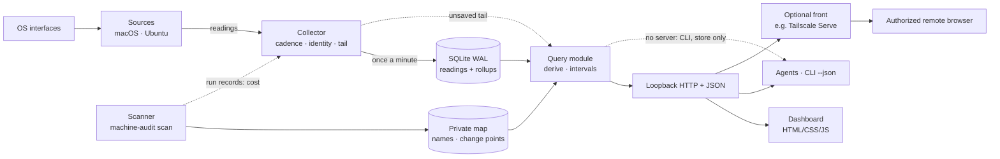

# Architecture

How Python collection, OS-specific sources, SQLite storage, interval queries
and the human and agent interfaces fit. A design proposal, not built or
validated on hardware; [implementation and validation](#implementation-and-validation)
says what evidence is needed. The [product brief](product-brief.md) owns scope and
boundaries, the [storage approach](storage-approach.md) owns cadences,
preservation and budget, and the [component views](machine-information.md) own
source meanings. [Installation and migration](installation.md) owns rollout and
target inventory.

## Collector and scanner, one-way data flow

One Python collector process per device, `machine-audit run`, started by the
user or the OS's service mechanism, plus the filesystem scanner,
`machine-audit scan`, a second process at background priority on its own schedule, so a long walk
never blocks the collector's thread. The two still share CPU, memory and
I/O; measured collector lateness during scans gates the scanner's schedule,
and the product's operating cost includes the scanner
([storage view](storage-view.md#grain-process-and-cost)). Data moves one way
through four parts:

1. **Sources** (OS-specific): where platform metric acquisition lives. A
   source bundles the OS calls one reading needs (the macOS process pass:
   `proc_pid_rusage`, `TASK_VM_INFO`, process start time) and returns source
   units with its own read bounds. State and event sources may deliver
   notifications instead of being polled.
2. **Collector** (portable): runs each source at its
   [accepted cadence](storage-approach.md#collection-baseline), stamps
   readings with boot id, run id and sequence number, holds the unsaved tail, writes.
3. **Store** (portable): one SQLite database in write-ahead-log mode, one
   transaction per minute, minute and hourly rollups alongside.
4. **Query and interfaces** (portable): one query module answers a selected
   interval with the [query design](query-design.md)'s answer shapes. A loopback
   HTTP server exposes it as JSON and serves the static dashboard; a `--json`
   command line asks the running server, or reads the
   store alone when nothing is running and says so.

Rollups and interval answers call the same named derivation functions
(`derive`), so a rule such as excess runnable per sample or non-additive memory
scopes exists once, including "a counter going backwards invalidates one field
for one window". A field's kind chooses the summary family; the function
decides validity. A cut interval is answered by its covered span, bounds
returned, identically for both interfaces.

Observation → reading (original source values and units, read bounds, status) → saved
as-is → differences and rollups derived from saved readings → interval answer.
Derivation never rewrites a reading
([preservation contract](storage-approach.md#preserve-readings-derive-summaries),
[CPU evidence option A](research/cpu-evidence.md#raw-snapshots-versus-validated-deltas)).
Packages: `sources/{macos,linux,self}`, `collector`, `store`, `query` (with
`derive`), `serve` and the static `dashboard`.

### Execution model

- **One thread per source**, each its own timer loop: a read never overlaps
  itself and there is no dispatch queue. Each loop records due time, actual
  start and completion; the collector thread derives status from those outside
  the loops, at each flush and status request. Lateness (start minus due) is
  kept separate from read duration; `skipped` marks ticks passed while a read
  ran; `hung` means running longer than ten cadences. One event per change. A
  hung source gets no replacement thread or stacked read; the others continue.
  Python cannot abort a thread, and a source that spins in Python or holds the
  interpreter lock in native code can still stall everything: isolation is per
  thread, not a guarantee. A restart clears it.
- **The collector thread owns the tail and the writer.** Sources append under
  one lock. Once a minute it copies readings up to a watermark, writes them in
  one transaction on the single write connection, then under the lock advances
  `committed` and drops the batch. A failed write leaves both unchanged. The
  collector also keeps a bounded recent-read cache, the latest reading and a
  fixed number of recent readings per source as read-only copies, for the
  [live view](query-design.md#five-answer-shapes); it is separate from the
  batch and never supplies unsaved readings to an interval answer.
- **Coherent snapshots.** Every reading carries the collector run id and a
  sequence number; a batch's rollups are written in the same transaction with
  the range they cover. A query takes `committed` and a copy of the tail above
  it under the lock, then opens its read transaction. Database readings and
  rollups must lie wholly at or below that run's watermark; the captured tail
  supplies the rest. Earlier runs are read as committed, with the
  span from each run's last save to its stop or the next start marked unknown,
  since that unsaved tail may be lost. The run id is the collector's, never
  the OS boot id.
- **Clocks and identity.** A source records wall, awake and continuous clocks
  around its actual OS calls and supplies the OS identity of what it read (pid
  plus start time, the group identity below). The collector adds boot id, due
  time, run id, sequence and receipt time; it standardizes formats and invents nothing.
  A source whose items lack a stable OS identity (a sensor list, a driver
  client with no pid) states its own identity rule and its weakness.
- **Serving** runs on the HTTP server's threads with read-only connections;
  at most a small fixed number of queries run at once. Each answer is bounded
  by its interval, an output row cap and a tail copy limited to the requested
  sources and span; a long interval is answered from rollups or paged with a
  cursor, and every answer returns the bounds and coverage it covered, so
  detail stays reachable and nothing is cut silently. The live view reads only
  the recent-read cache. A slow query shares the interpreter with
  reads; lateness and read duration show that interference. CPU cost comes from
  the self source.

### Source boundary

Adding a source adds its module and cadence, and may add store columns, a
derivation function and an answer field; the boundary keeps those additions
local, not absent. Each field carries its unit and kind: counter snapshot,
gauge sample, observed state, event, driver rate over the driver's own window,
or read-and-reset accumulator. Sources return numbers, stable ids and labels
passed through one shared [admission function](storage-approach.md#privacy);
command lines, paths, arguments, environment and raw logs never leave the
source. An Ubuntu group's label id is a salted hash of the cgroup path (keyed by
the private `identity.salt` in the data directory, as router identity is)
beside its admitted leaf label; the path is not stored. Lifecycle identity is separate: boot id plus cgroup directory
inode is the research's unverified candidate, and inodes can be reused, so a
same-path recreation may go undetected. A changed inode is a new group whose
first read is a baseline; continuity is uncertain until validated on the
target. Membership observations and coverage are kept.

### Measuring our own cost

The `self` source fulfills the [operating-cost contract](product-brief.md#cost-of-monitoring),
using existing process observations, scanner run records, store sizes and
operation counters where available. Track managed process instances, including
short-lived helpers; expose incomplete coverage. Record build/configuration
identity without secrets. Save self-cost through the normal store and query path.
Measure the added overhead; do not add a second process scan or high-frequency
polling just to measure the first.

## Failure behavior

Every failure is evidence: the collector keeps running, records what it could
not do, and never fills a gap with zero.

| Situation | Behavior | What the evidence shows |
| --- | --- | --- |
| Read fails or is denied | Keep the cadence; status `failed` or `denied` on the reading; one event per status change | Gap with reason; a denied source stays visible |
| Read outruns its cadence, or hangs | Skip, never stack; `hung` after ten cadences (above) | Lateness, duration, skipped and hung spans with actual times |
| Process exit, pid reuse, sleep, counter reset | The [time and coverage rules](cpu-view.md#time-windows-and-coverage-working); a new identity's first read is a baseline | Baseline rows, marked windows, coverage remainder |
| Restart or reboot | Start marker at launch, stop marker on clean exit; no stop marker means unclean | Gap from last save to restart, clean or unclean; new run id, and new boot id only after reboot |
| Save fails (SQLite error, disk full) | Keep collecting; retry each minute. The tail has a configured byte cap whose default comes from reading sizes measured in validation. **Recommendation needing approval:** at the cap, drop the oldest unsaved minute and count it | Live status: "unsaved since", buffered bytes, dropped count. A loss event is written when saving resumes; if the process dies first, only the gap remains |
| Budget or free space near a limit | Invariant: managed storage stays within 10 GB. Each store has one writer; all writers coordinate admission against one combined budget, reserving space before writing. Include database, sidecars, scanner index, transaction/rollup growth and checkpoint peaks. Check growth and prune old records proactively, reserving space for pruning as well as new writes. Admit a write only with sufficient reserved space and observed free-space margin; other applications can still consume free space. The builder chooses and validates the reservation mechanism and bounded write sizes before unattended operation; typical measured growth alone is not an upper bound | From 5 GB: alert state in both interfaces and a status event with size by part and growth rate |
| Budget reached | Prune old Machine-audit records to make room and keep writing. The [retention requirement](storage-approach.md#requirements) and pruning order are accepted; exact cutoffs remain open. If pruning fails, use the save-failure behavior above | Pruned record types and time ranges; remaining coverage; any failure to reclaim space |

## Permissions, private data, and dashboard access

- **Normal-user baseline.** The optional Mac administrator helper is not shipped
  yet. Future privileged sources require separate disclosed access decisions.
  Linux scheduler statistics are never
  enabled silently. Without helper access, other users' CPU is a labelled
  remainder; their memory is uncovered, never subtracted. No remediation path exists.
- **Private data directory**, mode 0700, holds the database, WAL, shared-memory
  sidecars and secrets. The scanner's separate store keeps its own name boundary.
- **Dashboard transport.** The application binds to 127.0.0.1 and admits only
  loopback hosts by default. Remote access goes through an operator-chosen front,
  such as Tailscale Serve, a reverse proxy or an ssh tunnel, as described in
  [installation](installation.md#dashboard-access). Admit loopback hosts and the
  configured `allowed_hosts`, with their exact permitted Origins; reject others.
  The front provides network access, while application authentication applies to
  both local and proxied API requests.
- **Authentication, working design.** Every API request carries a per-run token
  in an authorization header, read by the CLI from a 0600 file. Locally,
  `machine-audit open` launches the dashboard with the token in the URL fragment;
  the page keeps it in memory and removes it from the address bar. Remote opening
  needs an authenticated URL for a configured origin, obtained through
  authorized machine access. The builder validates that bootstrap and token renewal
  after a restart. Tokens never enter logs, stores or telemetry. This does not
  protect against a malicious process running as the same user; no unauthenticated
  shared-host default is permitted.

## Implementation and validation

**Scope.** The first Big Mac trial includes all seven
[components](machine-information.md), the scanner, retained readings and rollups,
the shared query layer, dashboard, agent readouts and self-cost reporting. Use the
[collection baseline](storage-approach.md#collection-baseline); unavailable device
features stay visible as gaps, not a reason to omit a component. GPU source
semantics and scanner cost must be checked during implementation. Optional
privileged paths retain their access gates. Ubuntu group CPU at the group-memory
cadence remains a working proposal, not a new accepted baseline.

Standard library plus `ctypes` is a working choice. Implementers validate native
calls, parsing and cost on each target, then record any necessary dependency.
The [storage view](storage-view.md#grain-process-and-cost) owns the scanner's
measured fallback choices. Neither compilation nor fixture tests establish OS
support. Ubuntu checks belong to the implementing agent, guided by the
[source notes](research/memory-gpu-sources.md#checks-for-the-ubuntu-target).

**Portable logic tests** cover counter resets and identity changes, sleep marking,
rollups against retained readings, cut intervals, program aggregation, snapshot
coherence, save failures, and budget/reserve accounting. Parser fixtures come from
scrubbed real captures; failure paths use disposable stores. These tests prove
logic, not hardware capabilities.

**Platform evidence** comes from the authorized installation on each target:
source fields and statuses; read duration and missed reads; collector and scanner
CPU, memory and writes; storage growth; and dashboard/query cost under normal
workloads. Exercise all components and both interfaces, including Tailscale access,
with the predecessor paused for the [Big Mac trial](installation.md#big-mac-first-user-trial).
Validate restarts, recovery, pruning and rollback; destructive tests use disposable
data. Sleep/reboot transitions use captured evidence, naturally occurring events,
or disposable targets, never forced disruption of a relied-on machine. Record
actual results, gaps and untested cases before unattended operation.

## Remaining choices and validation

1. **Retention cutoffs and buffer overflow:** set cutoffs and reclaim amounts
   from measured growth, following the accepted pruning order. Dropping the
   oldest unsaved minute at the memory-buffer cap remains a separate proposal.
2. **Access implementation:** validate the token bootstrap and Tailscale boundary
   above before exposure. Live installation remains separately authorized.
